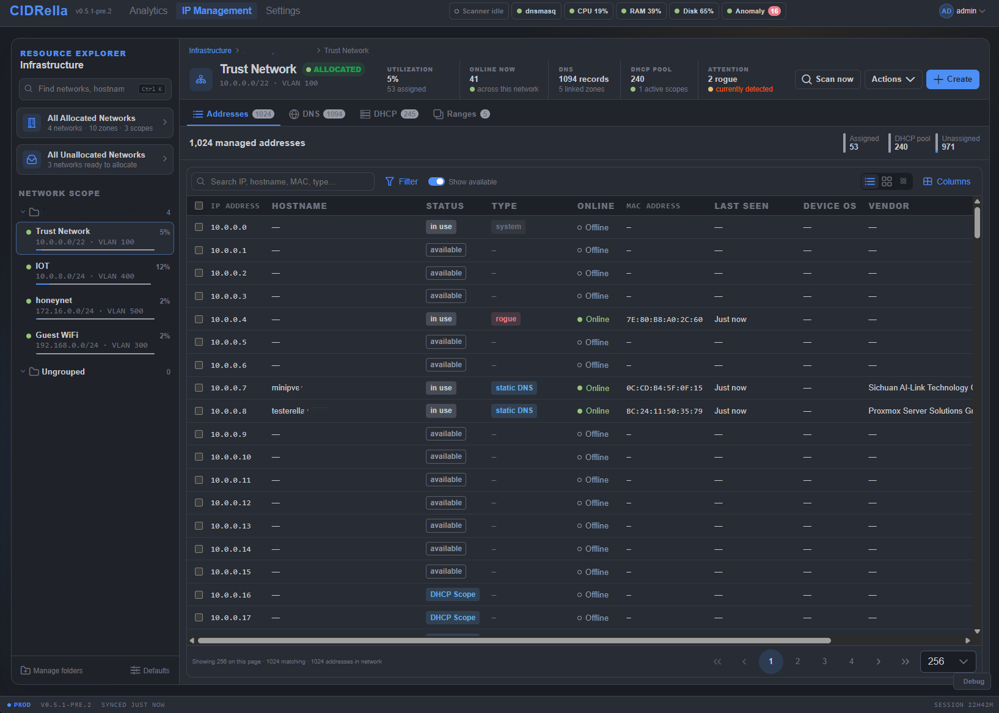

# CIDRella

[](https://scorecard.dev/viewer/?uri=github.com/fatcat/cidrella)
[](https://fatcat.github.io/cidrella/virustotal/)

Have a home network lab and need something better than a spreadsheet to plan and track your networks? Perhaps a small business, or even a medium-sized business. Need integrated address planning, DNS and DHCP all rolled into one, but found other solutions much too complicated (Netbox) or too simple (Pi-hole)? CIDRella is a lightweight IP Address Management system that requires minimal system resources (can be deployed as a container or LXC) and has a minimal learning curve.

Pronounced cider-ella, a lame, near-homophone of Cinderella. Why? It's complicated.

CIDR stands for Classless Inter-Domain Routing. Read about it [here](https://en.wikipedia.org/wiki/Classless_Inter-Domain_Routing).

## Features

* **IP address management**: Hierarchical subnets, folders, VLANs, functional ranges, table/grid views, and a canonical IP state model shared across Networks, DHCP, and DNS.
* **DNS management**: Forward and reverse zones with A, CNAME, MX, TXT, SRV, PTR records, SOA serial management, PTR sync, and direct dnsmasq config generation. 
* **DNSSEC validation**: Turns on dnsmasq DNSSEC validation against the root trust anchor.
* **Encrypted forwarders (DoT/DoH)**: Optionally encrypt CIDRella→upstream DNS via DNS-over-TLS or DNS-over-HTTPS through a built-in stub (no external daemon), with preset unfiltered resolvers (Cloudflare/Google/Quad9/AdGuard) or custom. 
* **DHCP management**: Scopes, global defaults for new scopes, per-scope options, DHCP Reservations, dynamic lease tracking, bulk updates, and DHCP-derived DNS records.
* **Choice of DHCP & DNS servers**: dnsmasq, or PowerDNS with Kea. Selectable during install or switch later.
* **IPv6**: Off by default. Turn it on under Settings, General, Interfaces to list the host's IPv6 addresses, listen on them, manage IPv6 networks, SLAAC, stateless or stateful DHCPv6 per network, DUID reservations, AAAA and ip6.arpa. Run the DHCPv6 and Router Advertisement checks.
* **Rogue DHCP and router detection**: Scheduled active probes (DHCPv4 DISCOVER broadcast, DHCPv6 SOLICIT multicast) that flag unauthorized DHCP servers answering on CIDRella's segments, plus rogue IPv6 routers read from the Router Advertisements the kernel accepted.
* **IP liveness and rogue detection**: Passive DHCP/DNS observations plus ARP-first active probes with ICMP fallback, scan history, and rogue IP classification.
* **Passive device/OS fingerprinting**: Identifies each DHCP client's device type and OS family from its DHCP fingerprint (options 55/60 + hostname) and MAC OUI, classified by an offline ruleset.
* **Analytics**: service status, rogue DHCP servers, rogue hosts, anomalous devices, scope conflicts, DHCP review, host performance, queries per minute, p95 latency, cache hit rate, timeouts, pending, process CPU and memory, and much more.
* **Blocklists and GeoIP filtering**: Category blocklists, scheduled refresh, and country-based allow/block modes through the DNS proxy.
* **Anomaly detection**: Observe and notify unusual query volume, new-domain patterns, beaconing, and DGA-like behavior.
* **Pi-hole import**: Standalone Settings workflow for importing Pi-hole DNS records, CNAMEs, DHCP Reservations, and upstream DNS settings.
* **Operations and recovery**: Signed native updates, scheduled backups, restore validation, reset-password and reset-web-port tools, log viewing, and audit history.
* **Certificate management**: Self-signed defaults, certificate upload, RSA/ECDSA CSR generation, and certificate/key validation.
* **Role based access control**: Admin, DNS, DHCP, and readonly roles with permission-checked APIs and audited mutations.

---

[](docs/screenshots/ip-table.md)

**[Browse all ten screenshots →](docs/screenshots/ip-table.md)** Each page has Previous and Next links.

---

## Host Sizing

CIDRella requires hosts with 1–2 GB RAM. Very large allocated subnets (e.g. `/10`, `/8`) will outgrow modest hosts long before DHCP lease counts become the bottleneck. See [docs/SIZING.md](docs/SIZING.md) for the ceiling-per-host table and the math behind it.

## Installation

> **Use caution**: While no known vulnerabilities exist in this application, it would be unwise to expose its open ports on a public network. Always secure your infrastructure.

> **Only install CIDRella from the official [GitHub releases](https://github.com/fatcat/cidrella/releases).** Starting with v0.4.1, every release tarball is cryptographically signed using [minisign](https://jedisct1.github.io/minisign/). Both the install script and the update script automatically verify the signature before applying changes. This ensures the tarball you are installing was built by the project maintainer and has not been modified. **Do not install or update using a tarball obtained from any other source.** There is no way to verify its authenticity or integrity. Each release's notes also link a [VirusTotal](https://www.virustotal.com/) scan of its tarball.

**Cloning the repository** is suitable for development and code review. For production deployments, use the install script or a release tarball. These include the pre-built frontend and are signature-verified.

### Option 1: Automated install (Debian/Ubuntu)

Generally speaking performing an install of any software including CIDRella in this manner is a terrible idea and should only be done to a host that is completely isolated and you're willing to sacrifice. Consult the [**INSTALL-NATIVE.md**](docs/INSTALL-NATIVE.md) for full details on alternate installation methods that afford an opportunity to review the code *before* installation.

Download and review the install script, then run it:

```bash
curl -sSL https://raw.githubusercontent.com/fatcat/cidrella/main/scripts/install.sh -o install.sh
less install.sh    # review before running
sudo bash install.sh
```

The script installs system dependencies, uses the bundled Node runtime from the release tarball, downloads the latest signed release from GitHub, verifies the signature, and configures systemd services.

### Option 2: Docker

For development and testing:

```bash
git clone https://github.com/fatcat/cidrella.git
cd cidrella
docker compose up -d --build
```

See [**INSTALL-DOCKER.md**](docs/INSTALL-DOCKER.md) for full details. Note: in-app updates are not available in Docker. Update by pulling the latest image.

### First run

The installer prints a one-time admin password. The first sign-in opens a five-step setup: replace that password, optionally add two-factor sign-in with an authenticator app and receive ten one-time backup codes (strongly encouraged), choose what the appliance does (DNS and DHCP, DNS only, or DHCP only) and on which interfaces, optionally bring in a Pi-hole's records and reservations or restore a CIDRella backup, then review and start.

## Upgrading

CIDRella checks for new releases on startup and every hour. When an update is available, a blue badge appears in the header bar.

**In-app (native deployments):**
Navigate to **Settings > Maintenance > Updates** and click **Install Update**. CIDRella will download the release from GitHub, verify the signature, back up the current installation, and apply the update automatically.

**Command line:**

```bash
# update to latest
sudo cidrella-update
```

```bash
# update to specific version
sudo cidrella-update --version 0.5.0
```

```bash
# install a local signed build
sudo cidrella-update --tarball /root/cidrella-v0.5.0-linux-x64.tar.gz
```

The update script (`/opt/cidrella/update.sh`) works the same way the in-app update works and performs the same steps.

**Docker:**

```bash
docker compose pull && docker compose up -d --build
```

> **Do not apply updates using tarballs downloaded from sources other than the official [GitHub releases](https://github.com/fatcat/cidrella/releases).** Manually extracting an unverified tarball bypasses signature verification and could compromise your network infrastructure.

## Web UI Ports

CIDRella's standard web UI ports are `443` for HTTPS and `80` for the HTTP-to-HTTPS redirect. Ports below `1024` require `CAP_NET_BIND_SERVICE`; the native systemd unit installed by CIDRella includes this capability.

If a web port change makes the UI unreachable, run:

```bash
sudo cidrella-reset-web-ports
```

This clears the stored web port overrides, re-enables the HTTP redirect, and restarts CIDRella so it falls back to the systemd defaults for the host.

## Architecture

See [docs/ARCHITECTURE.md](docs/ARCHITECTURE.md) for backend database ownership boundaries, model/service responsibilities, and guardrails.

| Layer             | Technology                                   |
| ----------------- | -------------------------------------------- |
| DHCP              | dnsmasq or Kea                               |
| DNS               | dnsmasq or PowerDNS                          |
| Backend           | Node.js + Express                            |
| Frontend          | Vue 3 + PrimeVue                             |
| Database          | SQLite (better-sqlite3)                      |
| Database          | DuckDB (for analytics and anomaly detection) |
| Custom            | DNS proxy (for domain and country blocking)  |
| Anomaly Detection | Python sidecar                               |
| Process Manager   | s6-overlay (Docker), systemd (native)        |

## Roles

| Role          | Description                              |
| ------------- | ---------------------------------------- |
| admin         | Full access to all features              |
| dns_admin     | Manage DNS records and zones             |
| dhcp_admin    | Manage DHCP Scopes and DHCP Reservations |
| readonly_dns  | View DNS configuration                   |
| readonly_dhcp | View DHCP configuration                  |
| readonly      | View all configuration                   |

## License

CIDRella is licensed under the [Apache License, Version 2.0](LICENSE). You may use, modify and redistribute it, commercially or not, as long as you keep the copyright notice, the license and the [NOTICE](NOTICE) file with every copy, and mark the files you changed. The NOTICE file also credits the IP geolocation data CIDRella includes, which DB-IP provides under CC BY 4.0.
